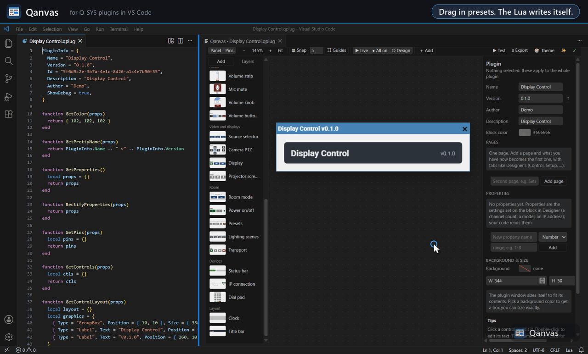
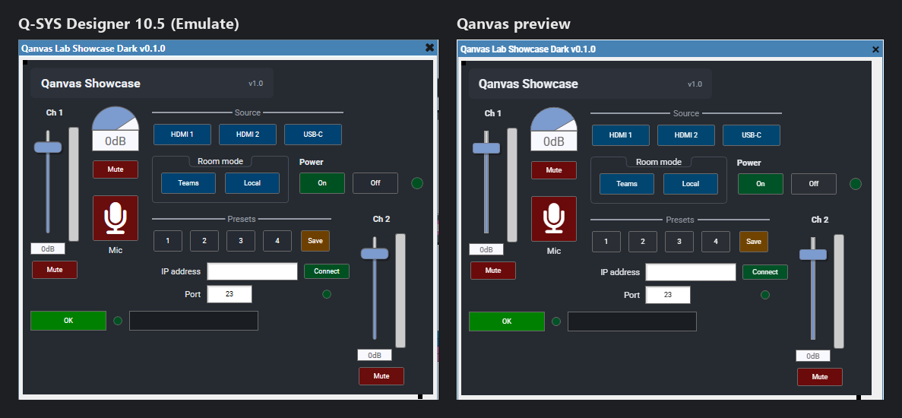
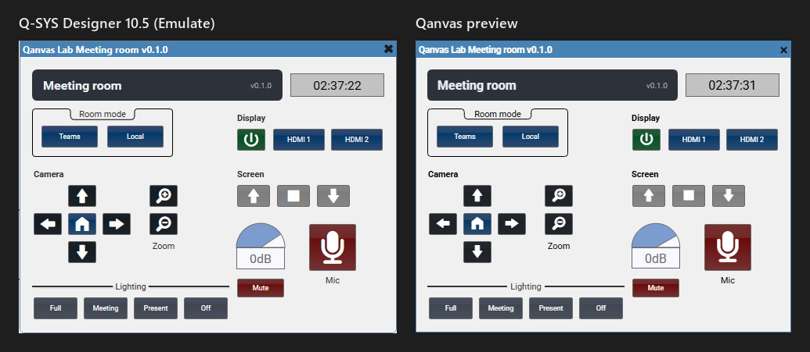

# Qanvas

**Live layout preview for Q-SYS plugins.** Your `.qplug` code is on one side and the plugin, drawn the way Q-SYS Designer draws it, is on the other. Edit the numbers and the preview moves. Drag in the preview and the numbers change.

No more restarting Designer to see whether a button moved 5 pixels.

**Drawn the way Designer draws it.** The same plugin in Designer 10.5 Emulate and in Qanvas:

**Test mode** runs your runtime code in the preview: buttons, faders and timers drive your EventHandlers, the console shows `print()`, errors and a Lua prompt, and your sockets talk to a pretend device you play from the console.

**Starters and presets** lay out a finished plugin in one click. This is the Meeting room starter, built entirely from presets, running in Designer and drawn by Qanvas:

## Install

In VS Code, open the Extensions view (**Ctrl+Shift+X**), search for **Qanvas** and click **Install**. Or download the `.vsix` from the [releases](https://github.com/1o1tm/Qanvas/releases) and run **Extensions: Install from VSIX…**.

## How to use it

1. Open a `.qplug` file.
2. Click the **layout icon** in the editor's title bar, or press **Ctrl+K Q**.
3. Write code, or drag things around. Both stay in sync.

The [guide](docs/GUIDE.md) walks through everything, step by step.

## What it does

- **Runs your real plugin code.** `GetProperties`, `GetControls`, `GetControlLayout`, `GetPins` and `GetPrettyName` run in an embedded Lua 5.3, the same version Q-SYS uses, so layouts built with loops, variables, pages and Properties all work.
- **Test mode: run it right here.** Press **▶ Test** and your runtime code runs in the preview: press buttons, drag faders and knobs, type into text boxes, pick from combo boxes, and watch your EventHandlers, interlocks and timers react. `print()` output and errors (with their line) show in a console with a Lua prompt into the running plugin, editing the code restarts the test, TcpSocket, UdpSocket, serial ports and WebSocket talk to a pretend device and HttpClient to a pretend server, all played from the console (type what they send back, see what your code sends byte for byte, drop the link to test your reconnect), or, with **Real network** on, to the real device on your desk; components and named controls are pretend ones you can change from **Values**; and the rest are harmless stand-ins that leave a note. **Values** lists every control's Value, String and Position as your code sees them, live. Test mode does what a Core does where Emulate differs: each call gets a Core's 200,000-instruction budget (the **Core** button turns orange or red, and its tab shows the heaviest calls), a plugin's own `Trigger()` doesn't run its handler, and `os.clock()` is CPU time. **⏩** fast-forwards timers, polling and timeouts. **Device rules** make the pretend device answer by itself ("when it receives PWR? it replies PWR=ON"), and **● Record** turns a session into a test that runs in VS Code's Testing panel and says what changed when the plugin starts doing something else. Crypto (Base64, hashes, HMAC, AES) computes for real, RampTime glides, and `rapidjson` and `json` behave like the Core's.
- **Looks like Designer, measured to the pixel.** Every control style was compared with Designer 10.5 screenshots: gloss and flat buttons, LEDs, value boxes, faders, knobs, meters, status, labels, group boxes, headers and Q-SYS's built-in icons. Switch the toolbar between **Live** (the way the plugin looks once the design runs: DefaultValues, plus whatever your runtime code sets at startup, in Designer's number formats like `-6.00dB`, `1.23kHz`, `L50`), **All on** and **Design** (blank, the way Designer shows a block that hasn't run). Multi-page plugins show Designer's page tabs; click one to switch pages. Checked against real plugins in Designer 10.5 Emulate.
- **Two-way editing:**
  - Drag to move (Ctrl-drag drops a copy), use the handles to resize, arrow keys nudge by 1 px (Shift: 10 px).
  - Select several and **scale them as one**: a keypad down, a row of LEDs up. Text sizes and corners follow, or set an exact Scale %.
  - Layouts your code builds with **loops, helper functions and lookup tables** can be dragged too: a drag changes the number they're made from (a helper's argument, a table entry, a loop's step), and everything made from the same number moves with it, live.
  - Double-click to edit text in place; F2 or right-click to rename.
  - Edits change only the numbers and fields involved. Formatting, comments and line endings are untouched, and Ctrl+Z undoes it.
- **Add anything from the palette:** every Q-SYS control and graphic, images (embedded the way Q-SYS expects), and **presets**: ready-made groups that look good together, like a volume strip, volume buttons that ramp while held, a source selector, room mode, power on/off, a display (power and inputs), a camera PTZ pad, a projector screen, lighting scenes, a transport, a dial pad, a status bar, an IP connection (a working TCP client), a device driver (a command queue with timeouts and retries, polling, a watchdog and reply handlers, with Test mode rules that play its device), preset store/recall, a mic mute, a clock and a title bar. Icons are Designer's own built-ins. Presets get unique names (Ch1Gain, Ch2Gain), pins grouped in folders, and working Lua where they need it (interlocked selectors, store/recall).
- **Themes and design kits:** Dark, Light, Midnight or back to Classic, with an accent color, plus a finish: rounded corners, a type scale, one font, group boxes as cards, positions on the grid. Previewed before you apply it, in one undoable edit. Colors that mean something (a red mute) are kept, and it's all properties Designer draws: what you see is what Designer shows.
- **Design check:** finds legends Designer will cut off, labels that don't fit, text that is hard to read on its background, edges 1 or 2 px off from their neighbours, sizes that almost match, buttons too small for a touch panel, and items sticking out of the background, each with a one-click fix (or Fix all).
- **Button icons:** Q-SYS's built-in icons (nothing embedded, tinted by IconColor), a searchable library of AV icons (embedded as SVG), or your own PNG/JPG/SVG.
- **Smart guides, snapping, align and distribute**, and an inspector with a color picker (your plugin's colors, recent colors, eyedropper), fonts, alignment and scrubbable numbers. Dragging snaps to edges and centers, and to **equal gaps**: midway between two neighbors, or repeating a gap already in the row, with the gap shown in pixels.
- **Layers:** the left panel's Layers tab lists everything on the page, top of the stack first: click to select (even things hidden under others), Shift/Ctrl-click to add, double-click to jump to the code, drag to change what's on top (written as ZOrder, as Designer stacks).
- **Edit many at once:** select several items and change their color, font, stroke, corners or alignment together ("mixed" shows where they differ). **Format painter:** Ctrl+Alt+C copies one item's look, Ctrl+Alt+V gives it to the selection, or click "Match X's look".
- **Copy and paste between plugins:** Ctrl+C in one plugin's preview, Ctrl+V in another's. The clipboard also gets the items as Lua, ready to paste into code.
- **Completions and hovers in the code:** type `Controls.` for your control names, then `.` for what that control has (`Boolean`, `Value`, `Legend`, `Choices`, an `EventHandler` snippet...), `Properties["` for your properties; hover a control name to see its type, pins and where it sits on the plugin. The Q-SYS libraries complete and explain themselves too: `TcpSocket.`, `Timer.`, `HttpClient.`, `Crypto.`…, and `sock:` on a socket you made lists its methods.
- **Linked to your code:** click a control to jump to its code, put your cursor in a layout entry to select it, add an EventHandler stub or insert snippets for a control, and see where your runtime code reads or writes it.
- **Pins view:** the schematic block as it comes out of Designer's library (its always-on pins; optional ones, like the Disable pin every block offers, are unticked until you tick them), and add pins from there.
- **Properties and block color:** with nothing selected, edit GetProperties as a form (change a default, add a number, choice, on/off or text property, remove one) and pick the block's color (GetColor, including QSC's `ConvertColor("#...")` template).
- **Grid arrange:** select several items and lay them out in N columns with a gap, in one step.
- **Problems and quick fixes:** Lua errors with the right line, controls never placed, duplicate names after copy and paste (one-click "make names unique"), a missing PluginInfo, GetProperties or GetControls (Designer won't load or place the plugin), a missing GetControlLayout, an empty Name or Id (generate a GUID), and built-in icon names Designer doesn't have. An empty `.qplug` becomes a new plugin in one click.
- **New Q-SYS Plugin…** starts from a clean plugin with all the functions Designer expects, or from a starter: Meeting room, Device driver or a Four-channel mixer, already laid out and working.
- **Colors in the editor:** `{ r, g, b }` colors and `"#rrggbb"` strings get inline swatches and VS Code's color picker.
- **Pages:** click a page tab to switch, **+** to add a page, double-click a tab to rename it (or use the Pages section of the plugin panel). New controls and graphics go on the page you're looking at. A plugin without pages gets the standard setup (a list of page names, GetPages, and an if/elseif in GetControlLayout), checked in Designer 10.5.
- **Datasheet:** **⇩ Export → Datasheet** (or *Qanvas: Export Plugin Datasheet*) writes a Markdown datasheet next to the plugin: a picture of every page, then its controls (type, pin, page), properties and audio pins. Ready for a GitHub README or a forum post.
- **Release check:** **⇩ Export → Release check** lists what to look at before sharing (a placeholder Id, no Version, ShowDebug on, leftover prints, IP addresses and passwords written into the code, Id clashes in Designer's Plugins folder), and the code follows as you go through the list.
- **Don't break wired designs:** renaming a control that designs already wire to (it has a pin in the copy in Designer's Plugins folder) asks first and offers to change only its pin name; **⇩ Export → Compare with another version** lists what designs using Designer's copy, the last commit or any file would lose (renamed or removed pins, changed controls and properties, a new Id).
- **Send to Designer:** **⇩ Export → Send to Designer** (or *Qanvas: Send to Designer*) puts the plugin in Designer's Plugins folder, and Designer's library has it straight away: no restart, no new name (a plugin linked into the folder is the exception: Qanvas leaves links alone, so restart Designer for it). It never replaces a different plugin without asking.
- **AI assistants can drive it:** GitHub Copilot in VS Code, Claude Code, Claude Desktop, Cursor and any app that supports MCP can see your plugin (the layout as data, and a picture drawn by the preview), change it through the preview's own engine (one undo step each), run the design and release checks, build a plugin from scratch, and test it in Test mode: press buttons, play the pretend device, read the console. It asks you before sending to Designer or using the real network, and nothing listens on the network. Setting each one up: the [guide](docs/GUIDE.md#11-ai-assistants).
- **Trace an image:** lay a mockup or a screenshot over the plugin (opacity, scale, position) and build to it. It isn't written to the code or the images you export.
- **Preview property values** without changing your code.
- **Keyboard shortcuts:** press **?** for the list.

## What it can't do (yet)

- A position Qanvas can't follow back to a number in the code exactly (worked out with a division and then rounded, `%`, an index into a table, or a library call) can't be dragged. It shows a lock and points you to the line.
- Test mode simulates the Q-SYS runtime APIs a panel needs (controls, timers, properties, JSON, Crypto, components and named controls, and TcpSocket, UdpSocket, serial ports, WebSocket and HttpClient against a pretend device you play or the real network); SSH doesn't talk to anything, and serial ports are always pretend.
- Designer draws text with ClearType; the preview uses the same font and positions but grayscale smoothing, so edges can differ by a pixel.

## Settings

| Setting | Default | |
|---|---|---|
| `qanvas.gridSize` | 5 | Grid size for snapping |
| `qanvas.snapToGrid` | on | Snap to the grid while dragging |
| `qanvas.smartGuides` | on | Snap to other controls' edges and centers |
| `qanvas.colorDecorators` | on | Color swatches in `.qplug` files |
| `qanvas.designerPluginsFolder` | (Designer's) | Where Send to Designer puts plugins |
| `qanvas.sendToDesignerOnSave` | off | Send to Designer on every save |
| `qanvas.assistantsOutsideVSCode` | off | Let AI assistants outside VS Code use Qanvas (see the [guide](docs/GUIDE.md#11-ai-assistants)) |

## Feedback

Found a bug, or missing something? [Open an issue](https://github.com/1o1tm/Qanvas/issues).

---

© 2026 Timothy McKinney. Free to use; see LICENSE. Q-SYS is a trademark of QSC, LLC. Qanvas is not affiliated with or endorsed by QSC.
